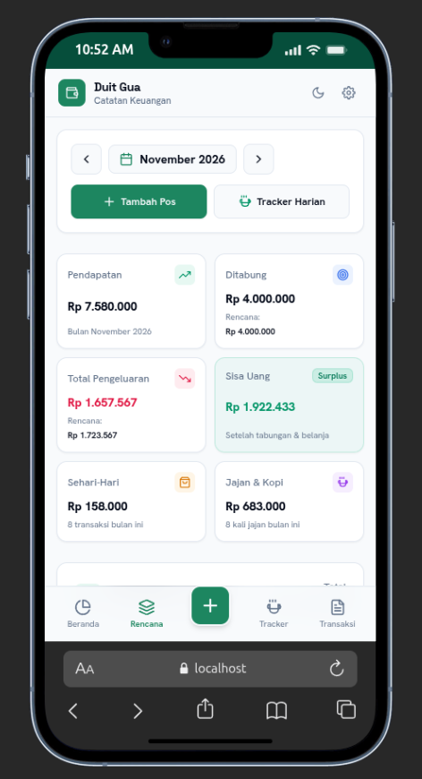

<p align="center">
  
</p>

<h1 align="center">Duit Gua (v1.2.0)</h1>

<p align="center">
  <strong>Aplikasi Pengelola Keuangan Pribadi Mobile-First</strong><br />
  Pencatatan keuangan harian cerdas, anti bokek, bertema <em>Soft Neo-Brutalism</em>, dan dapat diinstal langsung di HP (PWA).
</p>

<p align="center">
  
</p>

---

## Fitur Utama V1

- **Tampilan Mobile-First & Soft Neo-Brutalism**: Desain modern dengan garis tegas, bayangan taktil, dan navigasi bawah yang nyaman untuk pengoperasian satu tangan di HP. Mendukung Mode Terang & Gelap.
- **PWA (Bisa Diinstal di HP)**: Dapat dipasang langsung di layar utama smartphone (Android & iPhone) tanpa perlu download dari Play Store/App Store. Berjalan mulus secara *standalone*.
- **Login Fleksibel**: Mendukung **Masuk dengan Google**, Email & Password, atau langsung coba lewat **Mode Tamu (Offline)**.
- **Sinkronisasi Cloud & Offline-First**: Data tersimpan otomatis di HP secara offline dan tersinkron ke cloud Firebase saat online sehingga aman diakses multi-perangkat.
- **Multi-Dompet & Transfer**: Kelola berbagai jenis rekening (Tunai, Bank, E-Wallet) dan catat transfer antar dompet dengan validasi saldo otomatis.
- **Catat Transaksi Cepat**: Input pengeluaran & pemasukan dengan tombol hitung nominal cepat (+10k, +50k, +100k) dan filter kategori.
- **Pelacak Jajan & Nongkrong**: Form praktis khusus untuk mencatat jajan santai, ngopi, dan makan harian agar pengeluaran kecil tidak boncos.
- **Perencanaan Bulanan & Batas Anggaran**: Atur alokasi pos tabungan dan batas maksimal pengeluaran per kategori dengan indikator warna status anggaran.
- **Cadangkan Data**: Ekspor & impor data transaksi kapan saja dalam format JSON.

---

## Cara Instal di HP (PWA)

1. **Android (Chrome)**: Buka website aplikasi di browser Chrome HP, ketuk tombol **"Instal Aplikasi"** pada banner yang muncul di layar (atau buka menu titik tiga > pilih *Tambahkan ke Layar Utama / Instal aplikasi*).
2. **iPhone / iPad (Safari)**: Buka website di browser Safari, ketuk tombol **Bagikan (Share [↑])** di bagian bawah, lalu pilih **Tambahkan ke Layar Utama** (*Add to Home Screen*).

---

## Konfigurasi Singkat (.env)

Buat file `.env` di folder utama aplikasi dengan data dari Firebase Console Anda:

```env
VITE_FIREBASE_API_KEY=AIzaSy...
VITE_FIREBASE_AUTH_DOMAIN=project-id.firebaseapp.com
VITE_FIREBASE_DATABASE_URL=https://project-id-default-rtdb.firebaseio.com
VITE_FIREBASE_PROJECT_ID=project-id
VITE_FIREBASE_STORAGE_BUCKET=project-id.firebasestorage.app
VITE_FIREBASE_MESSAGING_SENDER_ID=000000000000
VITE_FIREBASE_APP_ID=1:000000000000:web:abcdef123456
```

---

## Perintah Cepat

```bash
# Menjalankan aplikasi secara lokal
npm run dev

# Kompilasi untuk naik ke produksi
npm run build
```

Hasil build produksi otomatis siap saji di folder `dist/` untuk di-upload ke Vercel, Netlify, atau Firebase Hosting.
